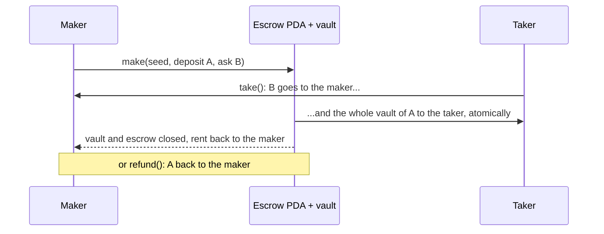

# anchor-escrow

[](https://github.com/Urthella/anchor-escrow/actions/workflows/ci.yml)

> **Unaudited** and not deployed. For learning and devnet.

A token escrow on Solana, written with [Anchor](https://www.anchor-lang.com) 1.x. The maker locks some of token A and names a price in token B; anyone who pays that price receives the locked tokens in the same transaction; until then the maker can take them back.



## Instructions

| Instruction | Signer | Effect |
|---|---|---|
| `make(seed, deposit, receive, expires_at)` | maker | Creates the escrow PDA `["escrow", maker, seed]` and its vault (the PDA's token account for mint A), and moves `deposit` into it. `expires_at` is a unix timestamp, `0` for never |
| `take()` | anyone, before expiry | Pays the maker `receive` of mint B, sends the vault to the taker, closes vault and escrow |
| `refund()` | maker, any time | Returns the vault to the maker and closes everything; an expired offer stays refundable |

Works with both SPL Token and Token-2022 mints through Anchor's `TokenInterface`; both mints of one escrow use the same token program.

## What keeps it safe

- **The escrow is pinned to its maker and mints.** `has_one = maker, mint_a, mint_b` and the PDA seeds are rechecked on every `take` and `refund`, so a different mint or a fake escrow account fails Anchor's constraints.
- **The maker is paid into their own associated token account**, derived from the escrow's `maker`, so a taker can't route the payment elsewhere.
- **Only the maker can refund**: `maker` must sign, and the seeds and `has_one` tie the escrow to that signer.
- **`transfer_checked` everywhere**, so decimals are verified by the token program.
- **Nothing is left behind**: the vault is emptied and closed, and the escrow account is closed, with all rent returned to the maker.
- **Bad offers are rejected up front**: zero amounts (`ZeroAmount`), trading a mint for itself (`SameMint`), and an expiry that has already passed (`ExpiryInPast`).
- **Expiry is strict**: at `expires_at` the offer is already closed to takers (`Expired`), so a maker never trades at a price after the moment they said it stops.

## Build and test

```bash
cargo build-sbf     # needs the Agave toolchain: https://docs.anza.xyz/cli/install
cargo test
```

The tests run the compiled program in [LiteSVM](https://github.com/LiteSVM/litesvm), an in-process Solana VM, so they need no validator and finish in seconds:

- a full make → take swap, checking every balance, the escrow's state and that all accounts close
- the same swap with Token-2022 mints
- refund, including a taker trying to refund in the maker's place
- paying with a mint the maker didn't ask for (`ConstraintHasOne`), with the vault left untouched
- zero amounts and same-mint offers
- expiry: takeable one second before the deadline, rejected at the deadline itself, refundable after it, and no deadlines in the past, using LiteSVM's `Clock` sysvar

**Dependency note.** LiteSVM 0.18 was built against Agave 4.3 but declares `^4.3`, which also accepts Agave 4.4, and 4.4 changed APIs it uses. The dev-dependencies pin the Agave root crates to `~4.3` (they pin each other exactly, so the whole family follows), with the reason in [Cargo.toml](programs/anchor-escrow/Cargo.toml).

`nix develop` gives Rust, the Solana CLI and Anchor CLI; `cargo build-sbf` comes from the Agave installer.

## License

[MIT](LICENSE)
